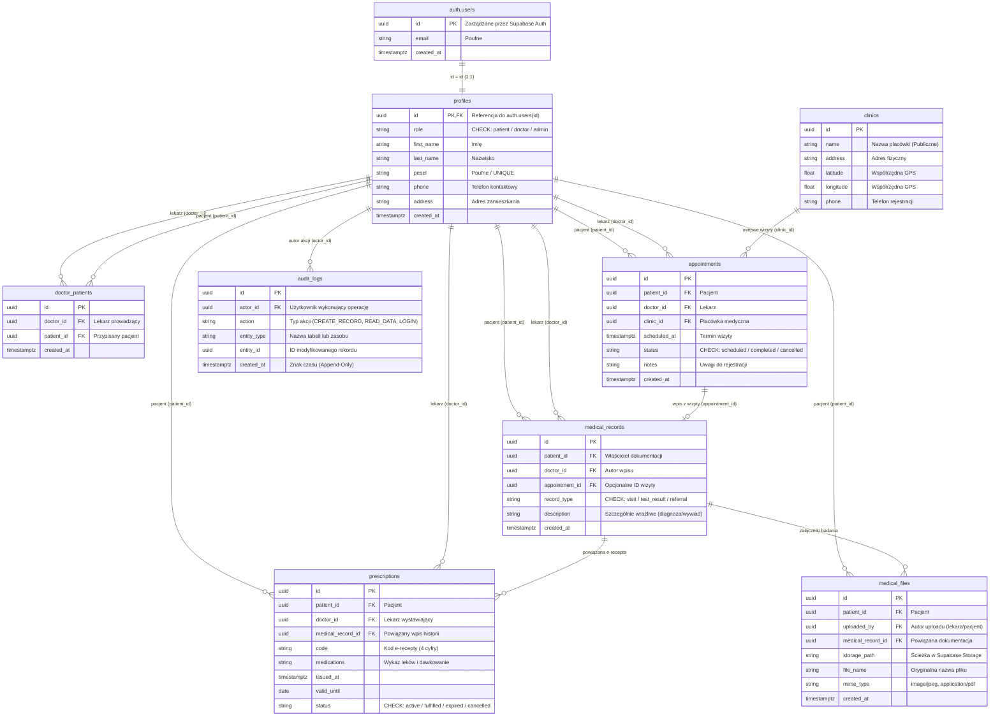

# Model Bazy Danych (ERD) — Mobilny Pacjent

Dokumentacja schematu relacyjnego PostgreSQL dla platformy Supabase. Model uwzględnia wymagania bezpieczeństwa aplikacji mobilnej (izolacja tożsamości, audytowalność, kontrola dostępu RLS).

---

## 1. Diagram Relacji (Mermaid ERD)

---

## 2. Podsumowanie architektury tabel i kluczy

| Nazwa tabeli | Rola w systemie | Klasyfikacja danych | Zabezpieczenie RLS |
|---|---|---|---|
| **`auth.users`** | Wewnętrzny schemat Supabase Auth (hashe haseł, sesje). | Poufne | Całkowity brak bezpośredniego dostępu z aplikacji mobilnej. |
| **`profiles`** | Zunifikowana tabela użytkowników (`role`: pacjent/lekarz/admin) + dane osobowe i PESEL. | Poufne | Odczyt: profil własny; lekarz widzi profile swoich pacjentów; modyfikacja: wyłącznie profil własny (bez zmiany roli). |
| **`clinics`** | Katalog placówek medycznych ze współrzędnymi GPS dla modułu mapy. | Publiczne | Odczyt: publiczny (nawet bez logowania); zapis/edycja: wyłącznie rola `admin`. |
| **`doctor_patients`** | Asocjacja lekarz–pacjent (klucz do weryfikacji BOLA/IDOR). | Poufne | Odczyt i tworzenie powiązań ściśle kontrolowane przez lekarza i admina. |
| **`appointments`** | Terminy i statusy wizyt lekarskich powiązane z konkretną placówką. | Poufne | Dostęp: pacjent do swoich wizyt, lekarz do wizyt w swoim kalendarzu. |
| **`medical_records`** | Historia zdrowia, wywiady, opisy badań i diagnozy medyczne. | **Szczególnie wrażliwe** | Odczyt: pacjent widzi wyłącznie swoje; lekarz wyłącznie dla przypisanych pacjentów (`doctor_patients`). |
| **`prescriptions`** | E-recepty i kody odbioru leków. | Poufne | Wgląd dla pacjenta i wystawiającego lekarza; edycja zabroniona po wystawieniu. |
| **`medical_files`** | Metadane plików binarnych (skany, PDF-y badań) trzymanych w Supabase Storage. | **Szczególnie wrażliwe** | Ściśle powiązane z uprawnieniami do prywatnego bucketu w Storage. |
| **`audit_logs`** | Dziennik zdarzeń weryfikujący niezaprzeczalność (STRIDE: Repudiation). | Wewnętrzne | Tabela **Append-Only** (tylko `INSERT`); brak uprawnień `UPDATE` i `DELETE` dla jakiegokolwiek użytkownika. |

---

## 3. Kluczowe reguły integralności i indeksy SQL

1. **Unikalność relacji lekarz–pacjent:**
   * Ograniczenie `UNIQUE(doctor_id, patient_id)` w tabeli `doctor_patients` eliminuje dublowanie relacji.
2. **Kaskadowe usuwanie profili:**
   * Klucz `profiles.id REFERENCES auth.users(id) ON DELETE CASCADE` gwarantuje spójność po skasowaniu konta w Auth.
3. **Optymalizacja zapytań (Indeksy):**
   * Indeksy na `appointments(patient_id, scheduled_at)` oraz `appointments(doctor_id, scheduled_at)` dla szybkiego filtrowania kalendarza wizyt.
4. **Ograniczenie ról w aplikacji:**
   * Walidacja wartości kolumny `role` przez warunek SQL: `CHECK (role IN ('patient', 'doctor', 'admin'))`.