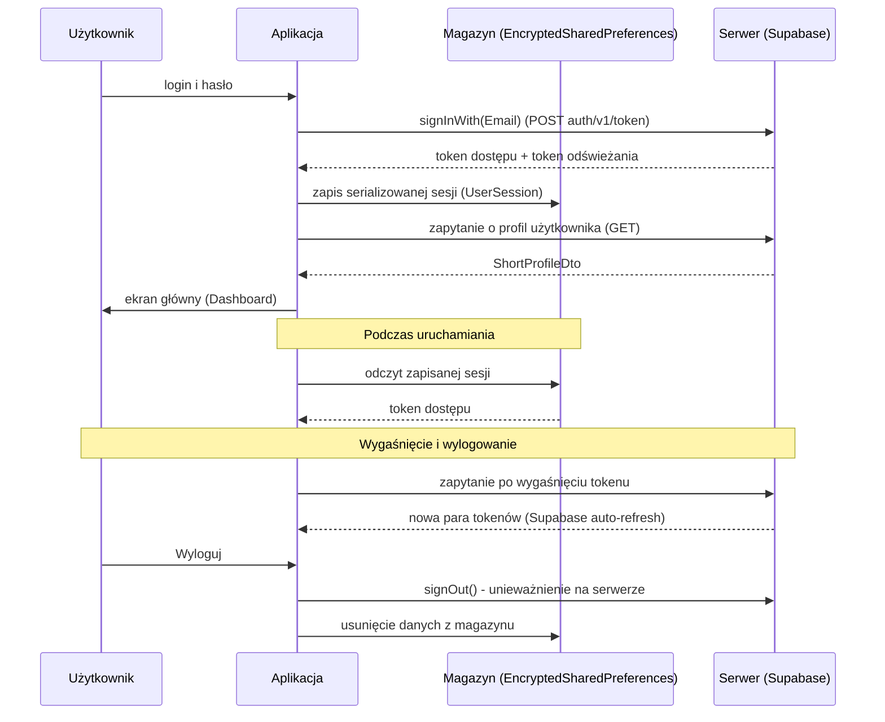

# Raport: logowanie i sesje

## 1.1 Elementy sesji

| Element                 | Gdzie powstaje        | Gdzie leży                                  | Ważny przez                     | Jak unieważnić                                  | Problem                                                    | Decyzja i źródło                                                 |
|-------------------------|-----------------------|---------------------------------------------|---------------------------------|-------------------------------------------------|------------------------------------------------------------|------------------------------------------------------------------|
| Hasło                   | Użytkownik wpisuje    | Nie jest trzymane lokalnie (tylko wysyłane) | Zależy od użytkownika           | Zmiana hasła                                    | Hasło wpisywane tekstowo (ryzyko podglądnięcia)            | Użycie biometrii po 1-szym logowaniu (`BiometricAuthManager.kt`) |
| Token dostępu (JWT)     | Serwer (Supabase)     | `EncryptedSharedPreferences` (AES256_GCM)   | 1 godzina (Supabase default)    | `signOut()`, upływ czasu                        | Jeśli przechwycony, daje autoryzację do API na krótki czas | Zapis z szyfrowaniem (`EncryptedSessionManager.kt`) wg MASVS     |
| Token odświeżania       | Serwer (Supabase)     | `EncryptedSharedPreferences` (AES256_GCM)   | Bezterminowo lub do wylogowania | `signOut()` usuwa z bazy serwera i z urządzenia | Wyciek umożliwia wystawianie nowych tokenów                | Szyfrowanie lokalnie. Przewidziane logowanie biometrią.          |
| Potwierdzenie biometrii | OS (BiometricManager) | Pamięć RAM                                  | Chwilowo - by odblokować sesję  | -                                               | Zwraca tylko true/false, nie podpisy kryptograficzne       | Wymuszono użycie `BIOMETRIC_STRONG` (Tylko bezpieczne czujniki)  |

## 1.2 Scenariusze

| Scenariusz                   | Co powinno się stać                                                          | Co dzieje się u nas                                                                                                                              | Jak sprawdziliśmy                                                           |
|------------------------------|------------------------------------------------------------------------------|--------------------------------------------------------------------------------------------------------------------------------------------------|-----------------------------------------------------------------------------|
| Wylogowanie                  | Sesja powinna zniknąć na urządzeniu i na serwerze                            | Wywołanie `AuthRepository.signOut()` usuwa z Supabase i lokalnego `EncryptedSessionManager`                                                      | Ręczny test: po wylogowaniu reset appki wymusza podanie hasła.              |
| Zgubiony telefon             | Sesja powinna zostać zablokowana by chronić dane medyczne                    | Mamy `SessionTimeoutManager`, po 15 minutach bezczynności blokuje dostęp                                                                         | Przez odłożenie telefonu na 15 min z włączoną aplikacją                     |
| Zmiana hasła                 | Stare sesje zostają usunięte przez Supabase (opcjonalnie)                    | Sesja Supabase reaguje zgodnie z ustawieniami serwera, ale można wymagać reloginu                                                                | Weryfikacja w dokumentacji gotowego rozwiązania (Supabase Auth)             |
| Token wygasa w trakcie pracy | SDK powinno odświeżyć token za pomocą tokenu odświeżania                     | Biblioteka `io.github.jan.supabase.auth` robi auto-refresh w tle                                                                                 | Praca z aplikacją powyżej 1h i odpytywanie API.                             |
| Reinstalacja aplikacji       | Kopia zapasowa w chmurze nie powinna logować automatycznie ze starego zapisu | Używamy `EncryptedSharedPreferences`, więc przy resecie sprzętowy klucz szyfrujący (MasterKey) jest invalidowany i sesja przepada (bezpiecznie). | Reinstalacja apki przez AS i sprawdzenie `EncryptedSessionManager.kt`.      |
| Przechwycony token           | Dostęp do API dla hakera maksymalnie przez czas 1h                           | Szyfrujemy storage (AES256_GCM), co utrudnia wyciągnięcie tokenu z roota.                                                                        | Podgląd plików aplikacji - zawartość `session` w prefs jest zaszyfrowana.   |
| Logowanie biometrią          | Logowanie szybkie, ale wymaga silnych uwierzytelniaczy                       | Użyte `BIOMETRIC_STRONG` – wymaga autentykatora Class 3                                                                                          | Sprawdzenie kodu `BiometricAuthManager.kt:16` i test na emulatorze bez PIN. |

## 1.3 Polityka sesji

| Parametr                                    | U nas teraz                                         | Docelowo                                           | Uzasadnienie i źródło                                                                          |
|---------------------------------------------|-----------------------------------------------------|----------------------------------------------------|------------------------------------------------------------------------------------------------|
| Ważność tokenu dostępu                      | 1 godzina (default Supabase)                        | 1 godzina                                          | OWASP MASVS-AUTH, krótki czas ważności JWT minimalizuje okno ataku.                            |
| Ważność tokenu odświeżania                  | Dopóki użytkownik się nie wyloguje                  | Ustalony w Supabase np. na 30 dni z auto-rotate    | Ograniczenie ryzyka długich rzutów. Wymaga ustawienia w panelu Supabase.                       |
| Wylogowanie po bezczynności                 | 15 minut                                            | 15 minut                                           | Aplikacja medyczna; MASVS-AUTH. Zastosowano `SessionTimeoutManager.kt` (`DEFAULT_TIMEOUT_MS`). |
| Limit nieudanych logowań                    | Zarządzane przez Supabase Rate Limiter              | Zarządzane przez serwer dostawcy                   | Unikanie bruteforce; gotowe w Supabase i nie wymaga obsługi klienta poza komunikatami błędu.   |
| Operacje wymagające ponownego potwierdzenia | Brak lokalnego potwierdzenia np. przy zmianie hasła | Zmiana hasła z podaniem starego                    | Implementacja bezpieczeństwa.                                                                  |
| Liczba aktywnych sesji i urządzeń           | Dowolna ilość                                       | W panelu Supabase - ograniczenie do kilku urządzeń | Lepsza kontrola sesji u pacjenta i personelu medycznego.                                       |

## 1.4 Decyzje

1. **Zastosowanie EncryptedSharedPreferences (AES256_GCM)**: Zamiast zapisywać tokeny JWT jawnym
   tekstem, dane zapisywane są szyfrowanie z użyciem `MasterKey` sprzętowego.
    * *Dowód/Źródło*: `EncryptedSessionManager.kt` linia 34
      (`PrefValueEncryptionScheme.AES256_GCM`). OWASP MASTG (bezpieczne przechowywanie danych).
2. **Mechanizm wylogowania po bezczynności (Session Timeout)**: Aplikacja dla pacjentów (dane
   wrażliwe medyczne) wymaga wymuszonego limitu sesji braku interakcji (np. zostawiony otwarty
   telefon). Wprowadzono 15-minutowy timer wylogowujący z sesji interfejsu (soft-logout wymagający
   ponownej biometrii lub hasła).
    * *Dowód/Źródło*: `SessionTimeoutManager.kt` linia 9
      (`const val DEFAULT_TIMEOUT_MS: Long = 15 * 60 * 1000L`). MASVS-AUTH, zalecenia HIPAA i RODO.
3. **Wymóg biometrii silnej**: Odciski palca lub inne bezpieczne metody autoryzacji biometrycznej
   dla szybkiego logowania, jako zastępstwo uwierzytelniania w warstwie UI po odświeżeniu sesji.
    * *Dowód/Źródło*: `BiometricAuthManager.kt` linia 16 (`Authenticators.BIOMETRIC_STRONG`).
      Dokumentacja Android Biometric API.
4. **Audytowanie logowań i wylogowań**: Zapis w bazie danych jako AuditLog operacji nawiązania
   (hasłem oraz biometrią) i zakończenia sesji z poprawnym identyfikatorem użytkownika.
    * *Dowód/Źródło*: `AuthRepository.kt` funkcja `signIn`, `signInWithBiometric` i `signOut` -
      `auditLogRepository.logEvent(action = "LOGIN/LOGOUT")`. Zgodność z MASVS, rozliczalność
      (non-repudiation).
