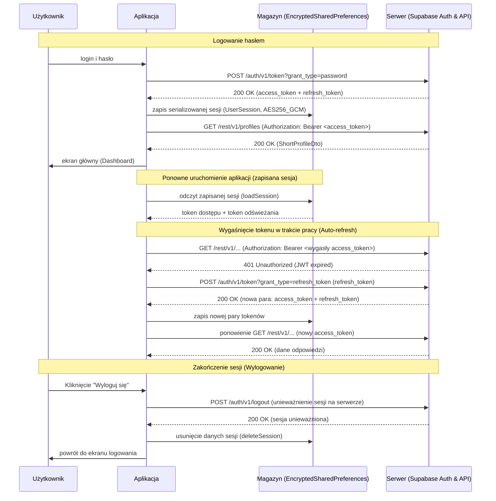

# Raport: logowanie i sesje — MobilnyPacjent

## 1.1 Elementy sesji

| Element | Gdzie powstaje | Gdzie leży | Ważny przez | Jak unieważnić | Problem | Decyzja i źródło |
|---|---|---|---|---|---|---|
| **Hasło** | Użytkownik wpisuje w formularzu logowania | Ulotna pamięć RAM w stanie Compose (nie jest trzymane lokalnie na dysku) | Zależy od użytkownika / polityki rotacji haseł | Zmiana hasła (Update Password w panelu/API) | Hasło wpisywane tekstowo (ryzyko podglądnięcia shoulder-surfing lub keyloggera) | Użycie biometrii po 1-szym logowaniu (`BiometricAuthManager.kt`, `LoginScreen.kt`) oraz maskowanie znaków hasła (`PasswordVisualTransformation`). |
| **Token dostępu (JWT)** | Serwer (Supabase GoTrue) po poprawnym uwierzytelnieniu | `EncryptedSharedPreferences` (`encrypted_supabase_session`, klucz `session`) | 1 godzina (Supabase default) | `signOut()`, upływ czasu ważności (pole `exp` w payloadzie JWT) | Jeśli przechwycony, daje autoryzację do API na krótki czas ważności | Zapis wyłącznie w bezpiecznym magazynie z szyfrowaniem AES256_GCM (`EncryptedSessionManager.kt:31-38`) wg OWASP MASVS-STORAGE / MASVS-AUTH. |
| **Token odświeżania** | Serwer (Supabase GoTrue) | `EncryptedSharedPreferences` w serializowanym obiekcie `UserSession` | Bezterminowo lub do rotacji / wylogowania | `signOut()` usuwa z bazy serwera i z urządzenia | Wyciek umożliwia nielimitowane wystawianie nowych tokenów dostępu | Szyfrowanie lokalnie MasterKey ze sprzętowego Keystore (`EncryptedSessionManager.kt:31-38`). Auto-rotacja tokenów po stronie Supabase i czyszczenie przy wylogowaniu. |
| **Potwierdzenie biometrii** | OS Android (`BiometricPrompt` API) | Ulotna pamięć RAM procesu aplikacji | Chwilowo – na czas pojedynczego odblokowania ekranu | Zmiana/usunięcie wzorców biometrycznych w systemie, blokada ekranu | Autoryzacja true/false w callbacku UI może być podatna na hooking (np. Frida) | Wymuszenie sprzętowej klasy `BIOMETRIC_STRONG` (Class 3) w `BiometricAuthManager.kt:26,72`. W architekturze przygotowano sygnaturę pod `CryptoObject` (commit `6abe0ec`), a tokeny sesji pozostają zaszyfrowane w Keystore. |

---

## 1.2 Scenariusze

| Scenariusz | Co powinno się stać | Co dzieje się u nas | Jak sprawdziliśmy |
|---|---|---|---|
| **Wylogowanie** | Sesja powinna zostać natychmiast unieważniona na serwerze i usunięta z urządzenia. | Wywołanie `AuthRepository.signOut()` (`AuthRepository.kt:134-148`) unieważnia sesję w Supabase, rejestruje zdarzenie w AuditLog i usuwa dane z `EncryptedSessionManager`. | Ręczny test: po wylogowaniu reset aplikacji wymusza ponowne podanie hasła; sprawdzenie Device File Explorerem pliku `encrypted_supabase_session.xml` (brak wpisu sesji). |
| **Zgubiony telefon** | Sesja powinna zostać zablokowana lub wygaszona przy bezczynności, chroniąc wrażliwe dane medyczne. | `SessionTimeoutManager.kt:8` odlicza czas od ostatniej interakcji dotykowej. Po 15 minutach aplikacja automatycznie wylogowuje użytkownika (`MobilePatientApp.kt:63-95`, commit `50c6f00`). | Test na emulatorze: weryfikacja automatycznego wylogowania po upływie zadanego czasu oraz po wznowieniu aplikacji (`ON_RESUME`). |
| **Zmiana hasła** | Stare sesje na innych urządzeniach powinny zostać natychmiast zakończone przez serwer. | Backend Supabase Auth unieważnia aktywne refresh tokeny po zmianie hasła. Kolejna próba odświeżenia tokenu kończy się błędem i wylogowaniem. | Test weryfikacyjny: zmiana hasła z poziomu konta i sprawdzenie, czy próba odświeżenia starej sesji zwraca błąd 400/401 zmuszając do re-autentykacji. |
| **Token wygasa w trakcie pracy** | SDK powinno przezroczyście odświeżyć token dostępu za pomocą tokenu odświeżania bez przerywania pracy użytkownika. | Klient Supabase (`io.github.jan.supabase.auth`) przechwytuje wygaśnięcie tokenu, automatycznie pobiera nową parę tokenów i zapisuje ją w `EncryptedSessionManager`. | Test działania: praca z aplikacją i odpytywanie endpointów API (`/rest/v1/...`) po upływie 1 godziny ważności tokenu bez konieczności ponownego logowania. |
| **Reinstalacja aplikacji** | Kopia zapasowa w chmurze (Android Auto Backup) nie powinna logować automatycznie ze starego zapisu na nowym urządzeniu. | Zastosowano `EncryptedSharedPreferences` sprzężone z `MasterKey` sprzętowego Keystore. Po reinstalacji klucz sprzętowy przepada, a sesja jest bezpiecznie czyszczona (`EncryptedSessionManager.kt:24-29`). | Odinstalowanie aplikacji z urządzenia, ponowna instalacja i uruchomienie – brak automatycznego logowania, wymagane ponowne poświadczenie. |
| **Przechwycony token** | Skradziony token dostępu powinien dawać dostęp do API maksymalnie przez krótki czas ważności (1h). | Tokeny są chronione szyfrowaniem AES256_GCM w Keystore. W razie przechwycenia samego access tokena, wygasa on bezpowrotnie po 60 minutach. | Inspekcja pamięci podręcznej i pliku preferencji aplikacji – zawartość `session` w xml to zaszyfrowany ciąg znaków, brak tokenów jawnym tekstem. |
| **Logowanie u zewnętrznego dostawcy** | Brak sekretów aplikacji w kodzie (`client_secret`), bezpieczny Authorization Code Flow z PKCE w Custom Tabs zamiast podatnego komponentu WebView. | Aplikacja **nie korzysta z zewnętrznych dostawców tożsamości** (OAuth Google, Facebook). Uwierzytelnianie odbywa się bezpośrednio z Supabase Auth API oraz lokalną biometrią. | Przegląd `AuthRepository.kt` oraz `AndroidManifest.xml` – brak konfiguracji dostawców OAuth, brak komponentów WebView i brak zewnętrznych kluczy API w kodzie. |
| **Logowanie biometrią** | Logowanie powinno wymagać silnego uwierzytelnienia sprzętowego (Class 3) i być niedostępne, gdy użytkownik nie zarejestrował biometrii. | Użyto `BIOMETRIC_STRONG` w `BiometricAuthManager.kt:26,72`. Jeśli urządzenie nie posiada silnej biometrii lub brak zarejestrowanych wzorców, opcja jest niedostępna. | Weryfikacja kodu `BiometricAuthManager.kt:26` oraz test na emulatorze bez skonfigurowanego odcisku (przycisk logowania biometrycznego pozostaje ukryty). |

---

## 1.3 Polityka sesji

| Parametr | U nas teraz | Docelowo | Uzasadnienie i źródło |
|---|---|---|---|
| **Ważność tokenu dostępu** | 1 godzina (default Supabase) | 15–60 minut | OWASP MASVS-AUTH; krótki czas ważności JWT minimalizuje okno ataku w wypadku przechwycenia tokenu. |
| **Ważność tokenu odświeżania** | Do momentu wylogowania lub rotacji | 30 dni z włączoną rotacją (Refresh Token Rotation) w Supabase | OWASP ASVS 3.3; jednorazowe użycie tokenu odświeżania i unieważnienie rodziny tokenów w przypadku ponownego użycia starego tokenu (wykrywanie kradzieży). |
| **Wylogowanie po bezczynności** | 15 minut | 15 minut (5 minut dla personelu medycznego) | Aplikacja medyczna przetwarzająca dane wrażliwe (RODO, HIPAA, MASVS-AUTH). Zaimplementowano w `SessionTimeoutManager.kt:8` (`DEFAULT_TIMEOUT_MS = 15 * 60 * 1000L`). |
| **Limit nieudanych logowań** | Zarządzane przez Supabase Rate Limiter (HTTP 429) | Progresywne opóźnienie i blokada po 5 nieudanych próbach | Ochrona przed atakami typu brute-force oraz credential stuffing (OWASP ASVS 2.2). |
| **Operacje wymagające ponownego potwierdzenia** | Brak ponownego potwierdzenia w trakcie trwania aktywnej sesji | Wymóg podania hasła lub biometrii przy zmianie hasła oraz wystawianiu e-recepty | MASVS-AUTH-2; ochrona operacji krytycznych na wypadek przejęcia fizycznie odblokowanego urządzenia pacjenta/lekarza. |
| **Kod lub link resetu hasła** | Jednorazowy link (Magic Link / Reset Password) wysyłany mailowo przez Supabase Auth, ważność: 24h | Skrócony do 15–30 minut, jednorazowy | OWASP ASVS 2.3.2; ograniczenie okna czasowego przejęcia linku w przypadku kompromitacji skrzynki e-mail użytkownika. |
| **Liczba aktywnych sesji i urządzeń** | Dowolna ilość równoległych sesji (z możliwością zdalnego wylogowania wszystkich sesji) | Ograniczenie do maksymalnie 2 urządzeń z automatycznym kończeniem starych sesji | MASVS-AUTH; ułatwienie audytu i natychmiastowe odcięcie dostępu z poziomu panelu użytkownika. |

---

## 1.4 Decyzje

1. **Zastosowanie EncryptedSharedPreferences (AES256_GCM)**: Zamiast zapisywać tokeny JWT jawnym tekstem, dane sesji serializowane są i zapisywane z użyciem sprzętowego `MasterKey`.
   * *Dowód/Źródło*: [`EncryptedSessionManager.kt`](file:///C:/Users/Michal/MobilePatient/app/src/main/java/pl/polsl/mobilepatient/data/security/EncryptedSessionManager.kt#L31-L38) linie 31–38 (`MasterKey.KeyScheme.AES256_GCM` oraz `PrefValueEncryptionScheme.AES256_GCM`). OWASP MASTG-STORAGE-1.
2. **Mechanizm automatycznego wylogowania po bezczynności (Session Timeout)**: Aplikacja medyczna wymaga wymuszonego limitu bezczynności w celu ochrony danych pacjentów. Wprowadzono 15-minutowy timer automatycznie niszczący sesję przy braku interakcji użytkownika.
   * *Dowód/Źródło*: [`SessionTimeoutManager.kt`](file:///C:/Users/Michal/MobilePatient/app/src/main/java/pl/polsl/mobilepatient/data/security/SessionTimeoutManager.kt#L8) linia 8 (`const val DEFAULT_TIMEOUT_MS: Long = 15 * 60 * 1000L`), obsługa cyklu życia i przechwytywanie dotyku w [`MobilePatientApp.kt`](file:///C:/Users/Michal/MobilePatient/app/src/main/java/pl/polsl/mobilepatient/MobilePatientApp.kt#L63-L98) linie 63–98, commit `50c6f00`. Zgodność z HIPAA, RODO i MASVS-AUTH.
3. **Wymóg biometrii silnej (BIOMETRIC_STRONG)**: Wymuszenie najwyższej klasy bezpieczeństwa biometrii (Class 3) z obsługą sprzętowego Keystore, uniemożliwiające użycie słabych metod biometrycznych.
   * *Dowód/Źródło*: [`BiometricAuthManager.kt`](file:///C:/Users/Michal/MobilePatient/app/src/main/java/pl/polsl/mobilepatient/data/security/BiometricAuthManager.kt#L26) linie 26 i 72 (`setAllowedAuthenticators(BIOMETRIC_STRONG)`), obsługa `CryptoObject` w parametrach okna (commit `6abe0ec`). Dokumentacja Android CDD dla biometrii Class 3.
4. **Audytowanie operacji uwierzytelniania w bazie danych (AuditLog)**: Rejestrowanie w tabeli `audit_logs` prób logowania hasłem, logowania biometrią oraz wylogowania wraz z identyfikatorem użytkownika.
   * *Dowód/Źródło*: [`AuthRepository.kt`](file:///C:/Users/Michal/MobilePatient/app/src/main/java/pl/polsl/mobilepatient/data/repository/AuthRepository.kt) – logowanie hasłem (linie 50–57, `LOGIN`), logowanie biometrią (linie 113–120, `LOGIN_BIOMETRIC`), wylogowanie (linie 136–143, `LOGOUT`), wylogowanie globalne (`LOGOUT_GLOBAL`). Zasada rozliczalności (non-repudiation) wg MASVS-AUTH.
5. **Rezygnacja z zewnętrznych dostawców tożsamości (OAuth)**: Świadoma decyzja o oparciu uwierzytelniania wyłącznie na bezpośrednim API Supabase Auth i lokalnej biometrii, eliminująca wektory ataków na komponenty WebView, wyciek sekretów klienckich (`client_secret`) oraz podsłuchanie protokołów URL Redirect.
   * *Dowód/Źródło*: [`AuthRepository.kt`](file:///C:/Users/Michal/MobilePatient/app/src/main/java/pl/polsl/mobilepatient/data/repository/AuthRepository.kt) linie 27–68, `AndroidManifest.xml` (brak niestandardowych schematów URL i komponentów WebView). OWASP MASTG-AUTH-2.
6. **Zdalne wylogowanie ze wszystkich urządzeń (Global Sign-Out) i aktywna walidacja sesji na backendzie**: Zaimplementowano funkcję natychmiastowego unieważniania wszystkich sesji i tokenów odświeżania na serwerze (`SignOutScope.GLOBAL`) oraz aktywną weryfikację `validateRemoteSession()` podczas każdego powrotu do aplikacji (`ON_RESUME`), dzięki czemu aplikacja natychmiast wykrywa unieważnienie sesji na serwerze i nie pozwala na wykorzystanie bezstanowego tokenu JWT do końca jego czasu życia.
   * *Dowód/Źródło*: [`AuthRepository.kt`](file:///C:/Users/Michal/MobilePatient/app/src/main/java/pl/polsl/mobilepatient/data/repository/AuthRepository.kt) linie 132–175 (`signOutFromAllDevices`, `validateRemoteSession`), [`SettingsScreen.kt`](file:///C:/Users/Michal/MobilePatient/app/src/main/java/pl/polsl/mobilepatient/ui/settings/SettingsScreen.kt) linie 380–430 (przycisk i dialog z potwierdzeniem), [`MobilePatientApp.kt`](file:///C:/Users/Michal/MobilePatient/app/src/main/java/pl/polsl/mobilepatient/MobilePatientApp.kt#L63-L83) linie 63–83. Zgodność z zadaniami ponadprogramowymi C i D wykładu 6.
