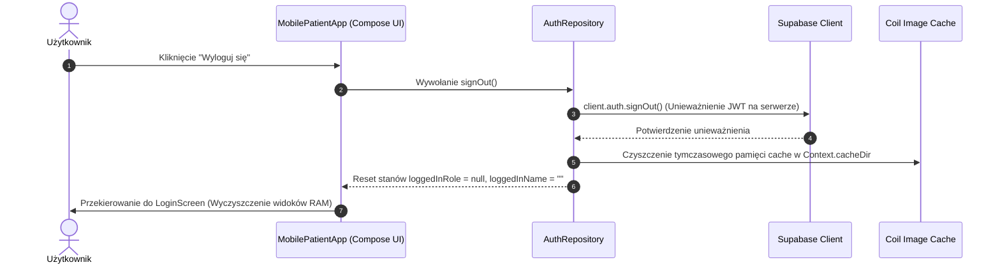

# D5: Polityka Sesji i Cyklu Życia Danych (Session & Data Lifecycle Policy)

Niniejszy dokument określa oficjalną politykę zarządzania sesją użytkownika oraz cyklem życia danych w aplikacji **MobilePatient** podczas kluczowych zdarzeń systemowych: wylogowania, reinstalacji aplikacji oraz wykonywania kopii zapasowej.

---

## 1. Procedura Wylogowania Użytkownika (Logout Event)

Akcja wylogowania może zostać zainicjowana ręcznie przez użytkownika (przycisk wylogowania) lub automatycznie przez system (np. w przypadku wygaśnięcia tokena `refresh_token` lub unieważnienia sesji po stronie Supabase).

### Krok po kroku: Czyszczenie danych przy wylogowaniu



1. **Unieważnienie sesji na serwerze:** Wywołanie `authRepository.signOut()` wysyła żądanie unieważnienia tokenów sesyjnych do Supabase Auth.
2. **Usunięcie tokenów z pamięci lokalnej:** Tokeny JWT (`access_token`, `refresh_token`) są usuwane z pamięci podręcznej klienta Supabase.
3. **Wyczyszczenie pamięci operacyjnej (RAM):** Zmienne stanu Compose (`loggedInRole`, `loggedInName`, obiekty DTO w ViewModelach) zostają zresetowane do wartości `null` / puste.
4. **Czyszczenie pamięci podręcznej dysku (Cache):** Katalog cache obrazów (`cacheDir`) zostaje wyczyszczony z tymczasowych podglądów zdjęć dokumentacji medycznej.
5. **Przekierowanie UI:** Interfejs natychmiast przełącza się na ekran logowania `LoginScreen`.

---

## 2. Reinstalacja Aplikacji (App Reinstallation Event)

W przypadku odinstalowania aplikacji przez użytkownika i ponownej jej instalacji ze sklepu Google Play lub pliku APK:

* **Automatyczne usunięcie danych:** System operacyjny Android fizycznie usuwa cały prywatny katalog aplikacji `/data/data/pl.polsl.mobilepatient/`, kasując wszystkie zapisane pliki preferencji oraz pamięć cache.
* **Brak przetrwania tokenów sesyjnych:** Ze względu na wyłączoną kopię zapasową (`allowBackup="false"`), nowe uruchomienie aplikacji po reinstalacji zawsze rozpoczyna się od stanu czystego (*Clean Install*).
* **Wymóg ponownego zalogowania:** Użytkownik musi ponownie wprowadzić swoje poświadczenia (e-mail i hasło) w celu uzyskania nowego tokena sesyjnego.

---

## 3. Polityka Kopii Zapasowej i Przywracania (Backup & Restore Policy)

Ze względu na przetwarzanie danych medycznych i danych osobowych (RODO / HIPAA), w aplikacji obowiązuje **bezwzględna polityka zakazu tworzenia kopii zapasowych** na poziomie systemu operacyjnego.

### Konfiguracja Bezpieczeństwa w `AndroidManifest.xml`

```xml
<application
    android:allowBackup="false"
    android:dataExtractionRules="@xml/data_extraction_rules"
    android:fullBackupContent="@xml/backup_rules"
    ...>
```

1. **Wyłączenie `allowBackup="false"`:** Uniemożliwia automatyczne tworzenie kopii zapasowej aplikacji w usłudze Google Auto Backup.
2. **Zasady `dataExtractionRules`:** Jawnie zabraniają ekstrakcji danych aplikacji za pomocą urządzeń zewnętrznych, kopii zapasowych przez magistralę ADB (`adb backup`) oraz transferów chmurowych.
3. **Efekt ochrony:** Żadne dane sesji, wpisy medyczne ani pliki cache nie mogą zostać wyciągnięte z urządzenia i przeniesione na inny telefon bez wiedzy i autoryzacji użytkownika.

---

## 4. Macierz Podsumowująca Politykę Sesji

| Zdarzenie | Stan Tokenów JWT | Stan Pamięci RAM | Stan Cache Obrazów | Stan Kopii Zapasowej |
| :--- | :--- | :--- | :--- | :--- |
| **Wylogowanie** | Unieważnione i usunięte | Zresetowane do `null` | Wyczyszczony | Brak wpływu |
| **Zamknięcie aplikacji (Kill Process)** | Zachowane w bezpiecznym magazynie | Wyczyszczona z RAM | Zachowana na dysku | Brak wpływu |
| **Reinstalacja** | Całkowicie skasowane przez system | Wyczyszczona | Skasowana | Odzyskiwanie zablokowane |
| **Próba Kopia Zapasowa (ADB/Google)** | Zablokowane pobieranie | Zablokowane | Zablokowane | **ZABLOKOWANA (`allowBackup=false`)** |
